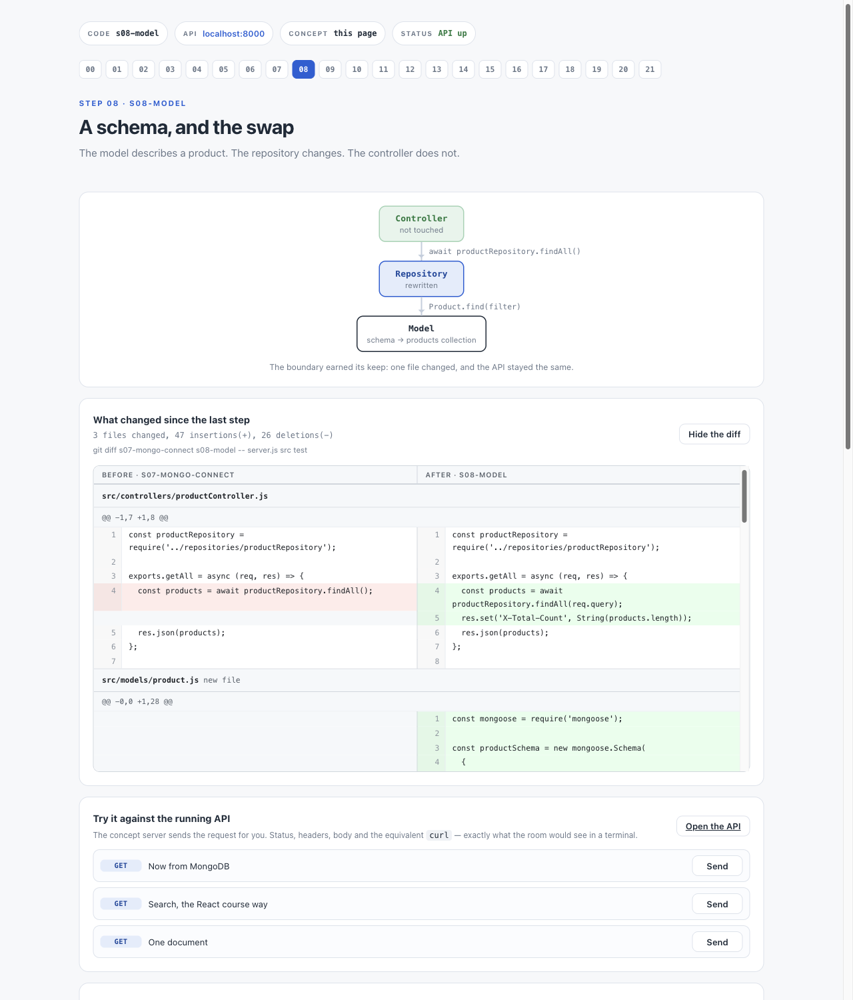

# START HERE

The course is three zones, and one command moves all of them.

| Zone | Where | What it is for |
|---|---|---|
| **CODE** | VS Code, this folder | the branch you are on |
| **API** | `http://localhost:8000` | the running server |
| **CONCEPT** | `http://localhost:5173/concepts/step.html` | the explanation for the current step |



The concept tab reads the git branch from the concept server every second. So
`npm run step 8` changes the code **and** the explanation. No reload, no tab juggling.

---

## One-time setup

Two terminals, one browser window, one tab.

```bash
# terminal 1 — MongoDB (in memory) + the API on :8000
npm run dev

# terminal 2 — the concept tab on :5173
npm run concept
```

Then open:

1. `http://localhost:5173/concepts/step.html` — the concept
2. `http://localhost:8000/products` — the raw API, when you want it

The first `npm run dev` downloads a MongoDB binary (~60 MB) and seeds six products.
After that it takes a second. The first `npm run step` opens the concept tab for you.

---

## The loop you repeat 22 times

```bash
npm run step 5
```

1. git checks out `s05-controllers`
2. nodemon reloads the API
3. the concept tab updates within a second
4. you read the line, ask its question, press a **Try it** button, then read **In depth**

Nothing else. No slides, no separate notes to keep in sync, no navigating to another
page: the idea, the data flow, the sequence diagram, the request and the diff are all on
the step page.

### The second pass: the diff

Every step page has an open **“What changed since the last step”** card, right under the
explanation. It is the real `git diff`, split into before / after columns with line
numbers — the command is printed under the summary.

Do this **after** the diagram, before you move on:

1. read the summary out loud: *“three files changed, forty-one insertions, six deletions”*
2. point at one red line on the left and the green line beside it
3. say the line: **the diagram explains it, the diff proves it**

If you would rather type it in the terminal, the exact command is on the card:
`git diff s05-controllers s06-repositories -- server.js src test`.

---

## The ten-minute dry run

Do this once before the session.

| Do | You should see |
|---|---|
| `npm run step 0` | six products from raw Node, no Express |
| `npm run step 3`, then POST a product | `201`, and the list has seven |
| `npm run step 8` | the same API, now from MongoDB, with `id` instead of `_id` |
| `npm run step 9`, POST with no title | `400` with `details: [{ field: "title" }]` |
| `npm run step 13` → “Create with no token” | `401`; “Create as demo” → `201`; demo delete → `403` |
| `npm run step 14` → “Rotate a refresh token” | `200`; the auth page can then show the reused token as `401` |
| `npm run step 15` → six bad logins | `401 ×5`, then `429` |
| `npm run step 18` → create, then read | the new product is in the list |
| `npm run step 21`, then `npm test` | ten tests, all passing |

If those nine behave, you can teach it.

---

## What you say, per step

The step page holds the short version and the long version:

- a one-line idea
- **In depth**: the explanation, a data-flow diagram, the tables from the HTTP / layers /
  folders / middleware / auth pages, an animated **sequence diagram**, and — where the
  step needs it — an inline JWT decoder, rotation demo, CORS fetch or middleware chain
- three bullets: what changed
- one code snippet
- **Try it**: real requests, with status, headers, body and `curl`
- **one question for the room**

Ask the question, wait three seconds, then answer it yourself. That silence is
where the learning happens; do not fill it.

The minute-by-minute version, with timings and the exact words, is
[`docs/run-sheet.md`](docs/run-sheet.md).

---

## The architecture thread

The course is not only “Express verbs”. Every third step moves a responsibility to its
own folder, and the step page names the boundary:

| Steps | The boundary |
|---|---|
| 4–6 | URL → controller → repository; the controller stops knowing where data lives |
| 7–8 | the repository stops knowing there is an array; Mongoose appears below it |
| 9 | every failure takes one path to one JSON shape |
| 11–14 | identity enters at the edge: register, login, token, middleware, refresh |
| 16–18 | cross-cutting concerns stay in middleware, never in the controller |
| 19–21 | config, docs and tests are the seams that let the app be operated |

The whole picture is [`ARCHITECTURE.md`](ARCHITECTURE.md). In the browser,
`concepts/folders.html` draws the tree and `concepts/sequence.html` plays the data
through it. The step pages embed the piece that belongs to the step, so you can teach
the whole thing without leaving the tab.

---

## The things that can go wrong

| Symptom | Fix |
|---|---|
| Concept tab says “Start the concept server” | `npm run concept` is not running |
| The status pill says “API down” | `npm run dev` is not running (terminal 1) |
| `npm run step` says no branch | you are not in this folder: `cd ~/Desktop/comp1682/node-express-crash-course` |
| The API restarts in a loop | the port is taken: `lsof -nP -iTCP:8000 -sTCP:LISTEN` |
| No products after a restart | the in-memory database is empty; `npm run seed` |
| MongoDB download fails on the first run | use your own MongoDB: set `MONGODB_URI` in `.env` |
| `npm test` cannot connect | it starts its own MongoDB; check the first-run download |

---

## The one sentence

> **Move the step, and all three zones move with it: the code in VS Code, the API in
> the terminal, and the explanation on the concept tab. Your job is to read the idea,
> ask the question, press one request, and let the diff prove it.**
